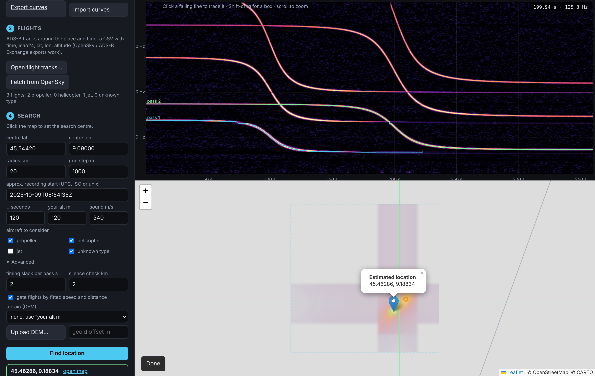
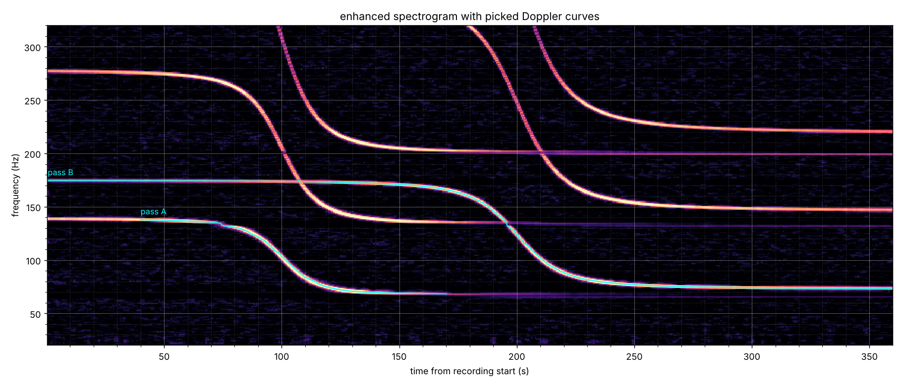
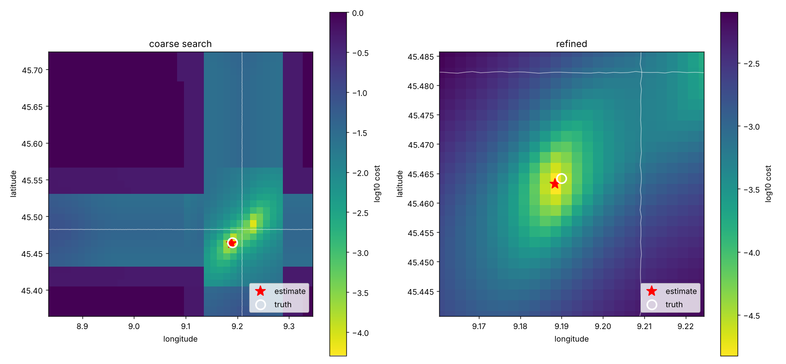

# Sound Geolocator

Estimate where (and when) a recording was made from the sound of aircraft passing overhead.

Planes are almost always within earshot, and every one of them broadcasts its position over ADS-B. When a plane passes, the pitch of its engine tones slides down: the Doppler effect. The shape of that slide depends on where the listener stands relative to the flight path. One pass narrows the listener down to a curve on the map. Two or more passes in the same recording share one clock, so the delay between them is known, and together they pin down a single point.

```
audio/video ──► spectrogram ──► enhance ──► pick Doppler curves ──┐
                                                                  ├──► grid search (position × start time) ──► location
ADS-B tracks (OpenSky / CSV) ──► simulate Doppler at each candidate position ──┘
```

## How it works

1. **Load audio** from any audio or video file (ffmpeg decodes video).
2. **Spectrogram** with a long window (1 s → 1 Hz bins), since Doppler shifts of a few percent on a 100 Hz tone are only a few Hz.
3. **Enhance**: remove stationary hum (per-frequency median over time), whiten broadband noise like wind and traffic (running median across frequency), and despeckle. Tonal aircraft lines (fan / propeller blade-passing tones and harmonics) remain.
4. **Pick curves**: click one point on a line (`--seed T,F`) or draw a box around it (`--box T0,T1,F0,F1`). A Viterbi ridge tracker follows the line. It penalises changes of slope rather than slope itself, so it handles steep sweeps and carries straight through places where other lines cross. Line strength is capped so a brighter crossing line is no reason to jump. By default the pitch may only fall, as it does in a single pass.
5. **Simulate**: for a candidate listener position, solve the retarded-time equation `t − τ = |P(τ) − O| / c` along each flight's smoothed ADS-B track, and compute the received/emitted frequency ratio `c / (c − v·n)`.
6. **Search**: on a grid of positions, slide all curves together along time (one shared unknown start time) against every candidate flight, fitting the unknown source tone frequency in closed form. Each curve takes its best-matching flight. The position and start time with the lowest total misfit win. The best few separated spots on the coarse grid are each refined, and the lowest cost wins.

The search follows the method described in colsto's video "This background sound leaks your exact location":

* **Locked multi-event scoring.** The passes share one clock, so the physical delay between them stays fixed. Each pass may still slide by a small timing slack (`--cpa-slack`, default 2 s) to absorb error in measuring its closest-approach time, and its tone frequency is fitted freely.
* **Speed and distance gate.** A straight-flyover fit of each curve gives the aircraft's speed and closest slant distance. A curve is only matched to flights with a similar ground speed, and only at spots where that flight's closest approach is consistent with the fitted distance.
* **Aircraft type filter** (`--types prop,heli,unknown`). ICAO type codes are classed as propeller, jet or helicopter. Propellers and helicopters give the clearest tones.
* **Terrain** (`--dem srtm30m`, a GeoTIFF, or .npz). Each candidate's height comes from a DEM.
* **Silence check** (`--silence-km 2 --recording-s 360`). A spot is penalised if a flight that matches none of your curves would have passed within that distance during the recording, because you would have heard it.

`sgeo fit` also fits a straight-flyover model to each curve on its own (tone frequency, speed, closest-approach time and slant range). It is a quick sanity check that a picked line really is an aircraft pass, and needs no flight data.

## GUI

From Spyder or another IDE: open `run_gui.py`, set `CLIP` to your recording and press Run (F5). It installs missing packages on first run and opens the GUI in your browser.

From a terminal:

```bash
sgeo gui        # opens http://127.0.0.1:8765
```

Open a recording and zoom into a pass. With **✎ Trace**, click a few points roughly along the falling line (two, at the start and end of the pass, are often enough) and press Enter. With **isolate + fit** on (the default) the pass is isolated from the noise and fitted in one go:

1. around the pass, every frequency has its 30 s running median removed (**⟷ s** sets the window), so hum, whines and any line that sits still vanish while the sweep stays; the **Lines removed** view shows the whole recording this way;
2. the smoothest falling ridge is traced between your clicks;
3. the flyover model is fitted and the ridge is traced again in ever narrower bands around the model curve (6 → 1.5 % of the frequency), refitting each time, so the trace can't step onto a crossing or horizontal line;
4. points more than 3 robust σ off the model are dropped and the final fit, with error bars, is made.

Check that the green model sits on the line; remove strays with **⌫ Erase** and **Fit** again if needed. With isolate + fit off, the old method is used (strongest bin in a ± Hz band around your clicks, then **Fit**). **⧉ New window** opens the current view (or one pass) in its own window, and all windows stay in sync. **∑ Model** explains the equations.

Then load flights (a whole-day archive, see below, or a CSV), click the map to set the search centre and press **Find location**, or press **Search worldwide** to search the whole day without assuming a place. Flight tracks can be switched on and off per aircraft type in the map's layer box. The demo button loads a synthetic case with a known answer. Everything runs locally, and the map tiles are the only thing loaded from the internet.



## Install

```bash
pip install -e .            # needs ffmpeg on PATH for video files
pip install -e '.[dev]' && pytest
```

## Quick start (synthetic demo with a known answer)

```bash
sgeo demo --out demo_out
# estimate 45.46322, 9.18834  true 45.46420, 9.19000  error 169 m
# start time error -1.0 s
```

`demo_out/spectrogram.png` shows the picked curves, and `demo_out/cost_map.png` shows the search:




## Real recordings

```bash
# 1. Look at the enhanced spectrogram and find descending tonal lines
sgeo spectrogram clip.mp4 --fmax 1500 --out spec.png

# 2. Pick at least two passes (seconds, Hz), then sanity-check them
sgeo extract clip.mp4 --fmax 1500 --seed 42,310 --seed 118,265 --out curves.json --plot picked.png
sgeo fit curves.json

# 3. Get ADS-B tracks for the area and time (see below), then search
sgeo locate curves.json tracks.csv --center 45.46,9.19 --radius 25 \
     --start 2025-06-01T14:03:00Z --uncertainty 300 --alt 120 --plot map.png
```

`--start` is your best guess of the recording's UTC start time (file metadata, upload time, clocks in frame), and `--uncertainty` is how far off it might be. `--center/--radius` define the search area.

### Flight data

`sgeo locate` reads a CSV of position reports. Column names are matched loosely: `time` (unix or ISO 8601), `icao24`/`hex`, `callsign`, `lat`, `lon`, and altitude as `alt_m`/`geoaltitude` (metres) or `altitude`/`alt_baro` (feet).

* **OpenSky REST API, recent data only** (`sgeo fetch-opensky --center LAT,LON --start ... --out tracks.csv`). Set `OPENSKY_CLIENT_ID` / `OPENSKY_CLIENT_SECRET` for authenticated access.
* **OpenSky historical database** (Trino, via `pyopensky`) for older recordings. Export state vectors to CSV.
* **adsb.lol daily history** (free, ODbL): one release per day at github.com/adsblol/globe_history_YYYY (`vYYYY.MM.DD-planes-readsb-prod-0`, about 4 GB in `.tar.aa`, `.tar.ab` parts). Put the parts side by side and open the `.tar.aa` in the GUI (step 3, *Whole day, worldwide*): it is converted once into a compact `.sgday` folder (airborne points below 7 km, every 3 s or more; about 0.8 GB and 2 to 3 minutes for a whole day), then opens instantly. From a terminal: `python -m sound_geolocator.adsb_day build v….tar.aa`. The conversion is resumable (`--budget SECONDS`). ADS-B Exchange historical data uses the same format.
* Any CSV with the columns above.

### Worldwide search

With a whole day loaded and two or more fitted passes, **Search worldwide** (or `DayArchive.search_world`) needs no search area. Every low aircraft sample with the right ground speed votes for the places abeam of it at about the fitted distance, and for the recording start time that would put the pass at the right moment. Places and times where different aircraft match every pass are candidates. Places with a lot of low traffic (airports) rank lower, because a mostly quiet recording can't have been made there. The best candidates are then checked with the full curve match (`refine_world`). Treat the result as a short list to inspect, not a final answer.

### Guided search, step by step (GUI step 4)

Pick the region in step 3 (worldwide, a continent or a country), then:

1. **Anchored search.** Choose the best-fitted pass as the anchor and tick the other passes. For every aircraft at the anchor's speed, every second of its track, the listener is placed abeam at the anchor's fitted distance (on the terrain), which also fixes the recording start. The other passes are placed the same way; only places where all of them agree on position and start time (fit errors, 3σ, plus a systematic allowance for the speed of sound and wind) are kept.
2. **Silence filter.** Places where another aircraft came within the per-type slant distance during the quiet stretches between the passes are dropped.
3. **Fit and rank.** The real aircraft tracks are simulated (retarded-time Doppler, reported GNSS velocity) and fitted to the passes (fitted model curves or digitised points). By default the position and start time are fitted to all passes together; the plot shows the misfit of the anchor against the others, with the time slide each other pass would prefer.
4. **Fine grid.** Around the selected place: misfit maps per pass and combined, drawn semi-transparent over the satellite map.

### Places that hear the passes, and the silence filter

**Find places that hear the passes** (step 4) lists every 2 km cell and start time, in the continental US or worldwide, where real flights match each ticked pass. The speed window is the fit's 3σ + 3 % + a wind allowance; the distance window is max(3σ, 20 %). The quiet stretches between consecutive ticked passes then act as a **silence filter** (`DayArchive.silence_ok`): a place is dropped when any other aircraft came within a slant distance during a gap. The distance is set per aircraft type (defaults: propeller and helicopter 3.5 km, jet 6 km, unknown 4.5 km), since a small plane is only heard from close by. Aircraft above the archive's 7 km limit never count. The survivors appear on the map as dots coloured by recording start; click one to make it the search centre.

Use tracks covering a few minutes before and after the recording. The sound heard at time *t* was emitted up to a minute earlier.

## Accuracy and limits

* **Speed of sound** (`--c`, default 340 m/s) varies with temperature, and wind shifts the curves. Both bias the result by hundreds of metres. Set `--c` from the local temperature when you know it (331.3 + 0.606·T°C).
* **Observer altitude** (`--alt` or `--dem`) should be on the same datum as the track altitudes. OpenSky `geoaltitude` is height above the WGS84 ellipsoid, while DEM heights are above sea level. Add the local geoid height with `--geoid-offset` (about +45 m in northern Italy).
* **Geometry matters.** Two passes on crossing tracks give a sharp fix. Two passes along the same route leave a long ambiguous strip.
* The ADS-B track has to cover each picked curve (80% by default). Aircraft without ADS-B (many small planes and helicopters) cannot be matched.

## Layout

| module | what it does |
|---|---|
| `audio.py` | load audio/video, resample |
| `spectrogram.py` | STFT, hum removal, whitening, despeckling |
| `extract.py` | isolating and fitting a pass from a few clicks (`isolate_curve`), digitising along a guide, ridge tracking (box or seed), curve cleaning, JSON I/O |
| `doppler.py` | retarded-time Doppler simulation, straight-flyover fit |
| `flights.py` | track model (smoothing spline in ECEF), CSV/OpenSky/readsb loaders |
| `adsb_day.py` | whole-day worldwide archive: conversion, area queries, worldwide search |
| `locate.py` | position × start-time search: locked multi-event scoring, gates, silence check |
| `aircraft_types.py` | ICAO type code → propeller / jet / helicopter |
| `elevation.py` | DEM from OpenTopoData, GeoTIFF or .npz |
| `gui/` | local web interface (`sgeo gui`) |
| `synth.py` | synthetic flights and recordings for tests and demo |
| `cli.py` | `sgeo` command |

## Responsible use

This tool can reveal where a recording was made. Use it on your own recordings, or for research and verification work where locating the recording is legitimate. Don't use it to track or expose private individuals.
