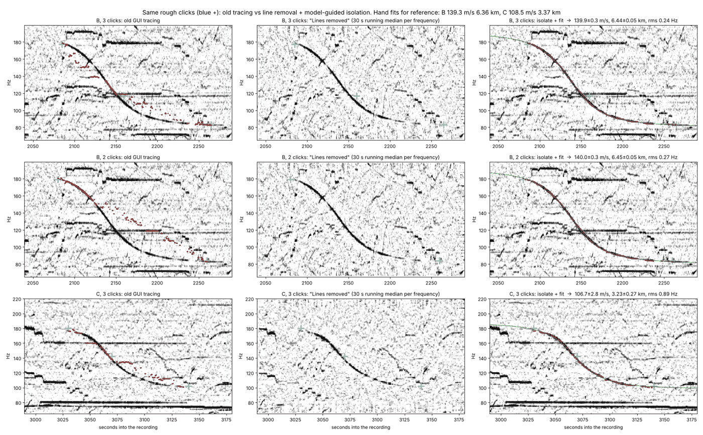

# Method

The idea and the overall method are from colsto's video [*This background sound leaks your exact location*](https://www.youtube.com/watch?v=UytYrhYLOKI); this software implements and extends it.

This document describes, step by step and with the equations used in the code, how Sound Geolocator turns a recording into a short list of places and recording start times. The README gives the overview and how to use the tools; this is the reference for what they compute.

Notation: the listener (observer) is at **O**, an aircraft is at **P**(τ) with velocity **v**(τ) at emission time τ, and *c* is the speed of sound (default 340 m/s). Recording time *t* is in seconds from the start of the file. The absolute start of the recording, *T*, is unknown.

---

## 1. Spectrogram

Audio is decoded with ffmpeg (any audio or video file), mixed to mono and resampled. The short-time Fourier transform uses a long Hann window (1 s, so 1 Hz bins) and a short hop (0.25 s). Long windows matter: the Doppler shifts of interest are a few percent of tones of 50–500 Hz, i.e. a few Hz, so frequency resolution beats time resolution here. Power is kept in dB, `P[f, t]`.

## 2. Enhancement and line removal (`spectrogram.enhance`)

Aircraft tones (propeller and fan blade-passing frequencies and their harmonics) are narrow lines that drift slowly. The enhancement makes such lines read as positive dB above the local background:

1. **Stationary components.** Subtract each frequency row's median, either over the whole recording, or over a sliding window of *W* seconds (`hum_window_s`):

   P₁[f, t] = P[f, t] − median_{|t′−t| ≤ W/2} P[f, t′]

   The sliding version (*W* = 30 s, the "Lines removed" view) also removes lines that last only minutes: a car idling, a fridge, a whine that changes in steps. A Doppler sweep crosses each frequency bin in much less than *W*/2 and survives. For speed, the running median is computed on 2 s block medians and interpolated back to every frame.
2. **Whitening.** Subtract a running median across frequency (40 Hz) in each frame. This flattens broadband noise (wind, traffic, speech) and keeps narrow lines.
3. **Despeckle** with a small median filter (1 bin × 5 frames), and clip below 0 dB.

## 3. Isolating one pass from a few clicks (`extract.isolate_curve`)

Real recordings are full of other lines, and a pass is often faint where it is steepest. Picking the strongest bin near a hand-drawn guide fails as soon as the guide is a little off: the trace steps onto whatever horizontal line is nearby. The isolation therefore uses the physics of the pass as the guide, not the clicks:

1. **Local line removal.** Around the pass (from the first to the last click ± *W*, band ± 30 % of the clicked frequencies), the *raw* spectrogram is enhanced with the sliding median of step 2 (*W* = 30 s by default).
2. **Ridge in a wide corridor.** Between two neighbouring clicks, every frequency from the lower to the higher click (plus a margin of 8 % of *f*, at least 4 Hz) is allowed. Inside this corridor the smoothest ridge is found by dynamic programming (Viterbi) on states (frequency bin, slope). Each change of slope costs a penalty, line strength is capped at 12 dB (a brighter crossing line is no reason to jump), and the slope may never be positive: in a straight pass the pitch only ever falls. The frequency grid is chosen so one bin per frame equals 1 Hz/s; the steepest allowed slope is 1.5 × the steepest click-to-click slope (at least 8 Hz/s). Each frame's peak next to the ridge is refined to sub-bin accuracy with a parabola through three bins.
3. **Model-guided refinement.** The straight-flyover model (§4) is fitted to that ridge. The ridge is then traced again inside a band around the *model curve*, and refitted, with ever narrower bands: 6 %, 4 %, 2.5 %, 1.5 % of *f* (at least 4, 3, 2, 1.2 Hz). The model carries the trace across faint stretches and crossing lines.
4. **Outliers.** Points more than 3 robust σ (1.4826 × median absolute residual, at least 0.3 Hz) off the model are dropped, and the final fit is made with error bars.

Two clicks, at the start and end of a pass, are usually enough. On the test recording, the old corridor method gave an unusable trace from the same clicks, while the isolation reproduced the careful hand digitisation within its error bars (pass B: 140.0 ± 0.3 m/s, 6.45 ± 0.05 km against 139.3 m/s, 6.36 km by hand).

## 4. The straight-flyover model (`doppler.fit_flyover`)

For one pass, assume a straight, level flight at constant speed *v*. Let *t*_cpa be the emission time of closest approach and *d* the slant distance then. Along-track position x(τ) = v (τ − t_cpa), so

  v_r(τ) = − v x(τ) / √(x(τ)² + d²),  t = τ + √(x(τ)² + d²) / c,  f(t) = f₀ · c / (c − v_r(τ(t)))

Four unknowns (f₀, t_cpa, v, d) shape the curve: f₀ sets its middle, *v* sets the ratio of approach to departure pitch, (c + v)/(c − v), and *d* sets how sharp the drop is (the slope at closest approach is about −f₀ v² / (c d)). They are found by robust non-linear least squares (soft-L1 loss), started from several distances (300 m to 8 km) to avoid local minima.

**Error bars.** Σ = s² (JᵀJ)⁻¹ · (1 + ρ)/(1 − ρ), where J is the Jacobian at the fit, s² the residual variance of the points the robust fit kept, and ρ the lag-1 autocorrelation of the residuals (neighbouring frames overlap and the aircraft wobbles, so there are fewer independent points than frames). These are statistical errors only. Wind (the fit gives air speed, ADS-B gives ground speed), temperature (the speed of sound) and a not-quite-straight flight add systematic errors, so the searches below use wider windows.

## 5. Simulating a real aircraft (`rank._track_grid`, `doppler.doppler_ratio`)

For a candidate listener **O** and start time *T*, a real ADS-B track predicts the whole curve. Sound received at absolute time *T + t* left the aircraft at τ, where

  T + t − τ = |**P**(τ) − **O**| / c   (retarded time, solved by a few fixed-point iterations)

and the received-to-emitted ratio is

  r(t) = c / (c − v_r),  v_r = **v**(τ) · (**O** − **P**(τ)) / |**O** − **P**(τ)|

The track is put on a 1 s grid in a local east/north/up frame: positions by a cubic Hermite curve through the reported positions, velocity from the reported GNSS ground speed and track (interpolated between reports), and vertical rate from the altitude over ± 10 s. Differences of noisy positions give velocity errors of several m/s, which shows up as about 1 Hz of misfit; the reported velocity removes it.

The unknown tone is solved in closed form for each pass: f̂₀ = Σ f_i r_i / Σ r_i², and the misfit is the rms of f_i − f̂₀ r_i in Hz.

## 6. Flight data (`adsb_day`)

A whole day of worldwide ADS-B (adsb.lol `globe_history`, about 4 GB) is converted once into a compact columnar archive (`.sgday`): airborne points below 7 km, at most one every 3 s, with time, position, altitude, ground speed and track, and per-aircraft metadata (ICAO address, callsign, type code). About 70 k aircraft and 45 M points per day; it opens in a second and is memory-mapped.

Aircraft types are classed from ICAO type codes as propeller, jet, helicopter or unknown (`aircraft_types.py`).

## 7. Search area

The search can be restricted to a region (`regions.py`): worldwide, a continent or one of about 25 countries, as latitude/longitude boxes. Restricting cuts both the work and the false matches.

## 8. Anchored search (`anchor.anchor_search`)

Choose the best-fitted pass as the **anchor**. From its fit, each pass gets a window (`anchor.pass_window`):

* speed: v ± (3σ_v + 3 % · v + wind allowance, default 15 m/s), since the fit gives air speed and ADS-B ground speed;
* distance: d ± (3σ_d + 3 % · d);
* closest-approach time: t_cpa ± (3σ_t + 3 % · d / c).

Then for every aircraft in the region whose ground speed is in the anchor's window, at every second of its track, the listener is placed **abeam** of it (perpendicular to its track, on either side) at the fitted horizontal distance, on the terrain. That fixes the recording start too: T = τ − t_cpa. Every other pass produces its own set of (place, start time, aircraft) points the same way. The sets are **joined**: a candidate needs every pass to be matched by a *different* aircraft at the same place (within the distance tolerance) and the same start time (within the time tolerance). The join hashes points into cells of place and time and checks neighbouring cells. Duplicates (same aircraft, start time within 3 s, same side) are merged.

## 9. Silence filter (`DayArchive.silence_ok`)

A recording that is quiet between two passes rules out places where another aircraft flew close during that gap: it would have been heard. For each candidate and each quiet stretch (from 10 s after one pass to 20 s before the next), any aircraft other than the matched ones that came within a slant distance is a veto. The distance depends on the aircraft type (defaults: propeller and helicopter 3.5 km, jet 6 km, unknown 4.5 km; a strict setting uses 2.5 / 4.5 / 3.5 km). Aircraft above the archive's 7 km limit never count. The check is done on candidate (cell, minute) keys against a presence grid of all traffic, in chunks, so it runs on a whole day in bounded memory.

## 10. Fit and rank (`rank.rank_candidates`, `rank.rank_locked`)

Each surviving candidate is checked with the full simulation of §5 using its own matched aircraft. A small batched Levenberg–Marquardt fit (thousands of candidates at once, numerical Jacobian) adjusts what the search only knew roughly:

* listener east/north offset, within ± 1.2 km of the candidate (± 3 km in the first version);
* listener height, from 100 m below to 150 m above the terrain;
* recording start shift, ± 5 s, shared by all passes;
* each pass's f₀, solved exactly.

Two modes:

* **Joint** (default): the position and start time are fitted to all passes together. Score = √((r_A² + Σ_k r_k²) / (1 + K)) in Hz, with r_A the anchor's misfit and r_k those of the other K passes.
* **Locked**: the anchor alone fixes position and start; each other pass is then scored with the start time fixed, and also with the time slide it would prefer (found by a scan of ± 10 s). A large preferred slide means the pass doesn't really fit there. Locked mode is fragile because a single pass has an along-track degeneracy (moving along the track and shifting the start time look alike).

Curves can be compared against the fitted model curve of each pass (smooth, default) or the digitised points.

## 11. Fine grid (`rank.misfit_grid`)

Around a chosen candidate, the misfit of each pass is mapped on a fine grid (e.g. 1 × 1 km at 5 m): at each point the listener height is the terrain, f₀ is solved exactly, and the start time is scanned over ± 4 s in 0.1 s steps. Three kinds of maps come out: each pass with its own best start time, all passes with one shared start time, and a weighted combination (each pass divided by its noise level, scaled back to Hz). They are drawn semi-transparent over the map.

## 12. Other searches

* **Local grid search** (`locate.locate`, the original CLI method): positions on a grid around a given centre × start times within a given uncertainty; locked multi-pass scoring with a timing slack per pass, speed/distance gates from the fits, a type filter, a DEM, and a silence penalty.
* **Worldwide voting** (`DayArchive.search_world` + `refine_world`): every low aircraft sample with the right ground speed votes for places abeam of it and for the start time; places and times voted by every pass are candidates. A first version, superseded by the anchored search.

## 13. Sources of error

* **Speed of sound.** *c* = 331.3 + 0.606 · T(°C) m/s. A 10 °C error is a 2 % error in fitted distance, about 100 m at 6 km.
* **Wind** shifts air speed against ground speed by its along-track component.
* **Manoeuvres.** A turning, climbing or accelerating aircraft is not a straight flyover; the fit gets worse and its errors underestimate the truth. The simulation of §5 uses the real track, so it handles manoeuvres; only the gates of §8 assume a straight pass.
* **Timing.** The fitted t_cpa is an emission time; the clock of the recording may drift; consecutive passes are tied by the recording's own clock, which is what gives the method its power.
* **Missing aircraft.** Aircraft without ADS-B (many small planes, helicopters, military) can't be matched, and can make a "silent" gap look busy or a real pass impossible to match.
* **Ambiguity.** Two passes along the same route leave a long strip of equally good places. Passes on crossing tracks give a sharp fix. Busy airspace gives many chance matches, which is why the silence filter and the full simulation matter.
